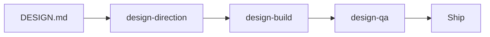

# Cursor Design Kit

Plantilla reutilizable para que **Cursor** diseñe e implemente UI/UX de nivel avanzado con skills de IA, reglas de proyecto y un `DESIGN.md` compartido.

- Texto para humanos: **español** (README, docs, reglas, plantillas).
- Nombres técnicos: **inglés** (skills, tokens, APIs).

## Qué incluye

| Carpeta | Contenido |
| --- | --- |
| `skills/` | Skills de terceros (con licencia verificada) + orquestación propia (`design-direction`, `design-build`, `design-qa`) |
| `rules/` | Reglas `.mdc` para copiar a `.cursor/rules/` de cada proyecto |
| `templates/DESIGN.md` | Plantilla de sistema de diseño con comentarios en español |
| `install.sh` / `install.ps1` | Instalador idempotente |
| `THIRD_PARTY.md` | Atribución, licencias y qué se copia vs. qué se instala |

## Requisitos

- [Cursor](https://cursor.com) con soporte de **Agent Skills** y **Project Rules**
- **Node.js** (para `npx`) — UI UX Pro Max, Impeccable, Vercel skills, shadcn, Motion Primitives
- macOS, Linux o Windows (PowerShell)

## Instalación

Clona este repositorio y ejecuta:

```bash
chmod +x install.sh
./install.sh
```

Instalar skills **y** preparar un proyecto:

```bash
./install.sh --project /ruta/a/tu-app
```

Opciones útiles:

- `--skip-external` — solo copia skills empaquetadas en el kit (sin red)
- `--force-design` — sobrescribe `DESIGN.md` en el proyecto destino

En Windows:

```powershell
.\install.ps1 -Project C:\dev\tu-app
```

El script:

1. Copia a `~/.cursor/skills/` las skills con `SKILL.md` del kit.
2. Instala **UI UX Pro Max**, **Impeccable** y **Vercel agent-skills** (incl. `web-design-guidelines`) con sus CLIs oficiales.
3. Con `--project`, copia `rules/` → `.cursor/rules/` y la plantilla `DESIGN.md`.

Detalle de licencias: [THIRD_PARTY.md](./THIRD_PARTY.md).

## Flujo de trabajo recomendado



### 1. Definir estilo (`DESIGN.md`)

Copia la plantilla o pide al agente documentar un producto existente:

> Usa la skill **create-design-md** para generar o actualizar `DESIGN.md` a partir de este repositorio. Sigue la plantilla del Cursor Design Kit.

### 2. Dirección visual (`design-direction`)

> Lee `DESIGN.md`. Ejecuta el flujo **design-direction**: propón dirección con **frontend-design**, refina con **ui-ux-pro-max** y aterriza decisiones de ingeniería con **emil-design-eng**. Actualiza `DESIGN.md` con tokens concretos.

### 3. Construcción (`design-build`)

> Implementa [pantalla/feature] siguiendo **design-build**: shadcn/ui, Motion Primitives `@0.1.0`, tokens de `DESIGN.md` y reglas en `.cursor/rules/`.

En el proyecto:

```bash
npx shadcn@latest init
npx motion-primitives@0.1.0 add text-effect   # ejemplo
```

### 4. QA de diseño (`design-qa`)

> Ejecuta **design-qa** sobre [ruta o URL local]. Encadena Impeccable critique/polish, web-design-guidelines, break-ui, review-animations, mobile-native y webapp-testing. Entrega el reporte en español.

### Prompt combinado (greenfield)

> Instala el Cursor Design Kit en mi máquina, copia reglas y `DESIGN.md` en este repo, define dirección para [producto], implementa el landing principal y pasa design-qa antes de terminar.

## Skills propias del kit

| Skill | Rol |
| --- | --- |
| `design-direction` | Orquesta dirección antes de codear |
| `design-build` | Implementación alineada a `DESIGN.md` |
| `design-qa` | Pipeline de revisión y reporte |

## Reglas de proyecto

Tras `./install.sh --project .`, tendrás en `.cursor/rules/`:

- Leer `DESIGN.md` antes de cualquier UI
- Basar componentes en **shadcn/ui**
- Accesibilidad mínima (WCAG AA)
- Evitar estética genérica “hecha por IA”
- Fijar **Motion Primitives** en beta (`motion-primitives@0.1.0`)

## Usar como plantilla de GitHub

1. Crea un repositorio desde esta plantilla (o fork).
2. En cada máquina de desarrollo: `./install.sh`.
3. En cada app nueva: `./install.sh --project ./mi-app` o copia manual de `rules/` + `templates/DESIGN.md`.
4. Mantén `DESIGN.md` en la raíz del producto como fuente de verdad visual.

## Licencia

Código y documentación original del kit: **MIT** © Jesús Díaz de León — ver [LICENSE](./LICENSE).

Las skills y assets de terceros conservan su licencia; no se reclama copyright sobre ellos.
